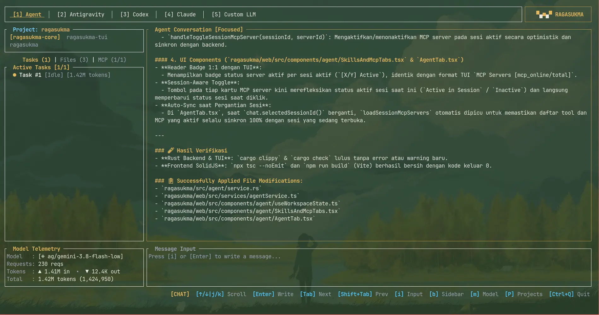

  

  # Ragasukma TUI
  **A friendly project sidekick that lives in your terminal, where the coffee is imaginary but the bugs are very real.**

  
  
  

  

    Ask Ragasukma to understand, tidy up, fix, and grow your project—without making you leave the terminal nest.
  

  

    
  

---

## What is Ragasukma TUI?

Ragasukma TUI is a terminal workspace where you and an assistant can wrestle with your files and projects together. Describe what you need in plain English: find a suspicious bug, repair a page having a dramatic moment, clean up some code, or build a new feature from scratch.

It helps with the work, but you remain the captain of this slightly chaotic spaceship. You can review every proposed change before it touches your files. No surprise moustaches on your codebase.

## What can it help with?

- **Understanding a project** — ask about files, structure, or that mysterious folder everyone is politely ignoring.
- **Fixing and building** — track down bugs, tidy code, or create new features without summoning ancient documentation.
- **Reviewing changes** — inspect proposed edits before they move into your files and rearrange the furniture.
- **Working across folders** — save and switch between projects from one workspace.
- **Keeping several threads alive** — move between project sessions without losing the plot, the context, or that one very important “I’ll fix it later” note.
- **Using your project’s playbook** — Ragasukma can pick up instructions and reusable skills stored with your project, so it has fewer excuses to ask the same question twice.
- **Bringing extra helpers** — connect MCP-powered tools when a project needs abilities beyond the usual toolbox. More hands, fewer dramatic sighs.
- **Getting more done at once** — keep independent work moving in parallel instead of making every task stand in a single-file queue.
- **Picking up where you left off** — conversations and work context stay local, ready for your next "wait, what was I doing?" moment.
- **Staying focused** — a lightweight, keyboard-friendly interface for people who prefer their hands to remain on the keys.

## Who is it for?

Ragasukma TUI is for anyone who works with project files and wants a helpful companion close to their daily workflow: developers, students, tinkerers, and brave souls maintaining a personal project at 2 AM.

---

## License

Released under the [MIT License](LICENSE) — free to use, change, and share. Go forth responsibly, or at least with a decent commit message.

Made by **Ahlan Saputra** ([@ahlanefwolf](https://github.com/ahlanefwolf)).
Copyright (c) 2026 Ahlan Saputra.
